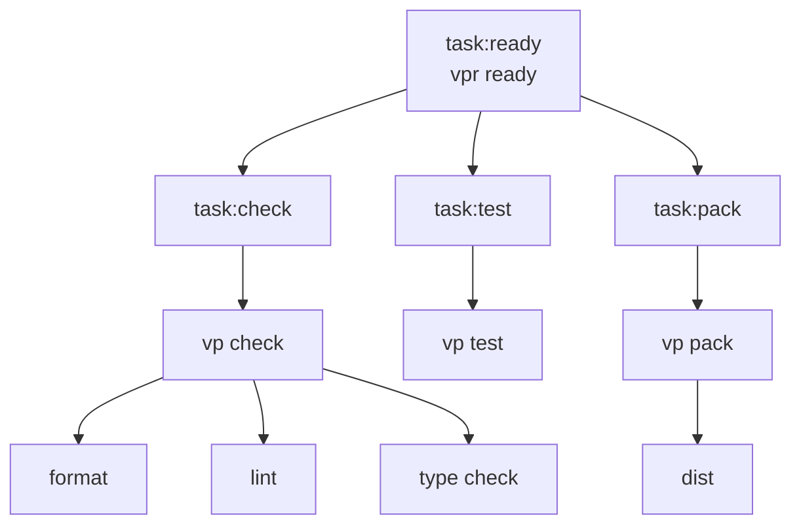

# vp-lib

A minimal [Vite+](https://viteplus.dev/) TypeScript library template for a single publishable npm package.

This template is intentionally thin. It includes one root library package, strict TypeScript, Vite+ formatting/linting/checking/testing/packing, Changesets releases, GitHub Actions, and scoped issue/PR workflows without adding a monorepo or demo app.

## Template Setup Checklist

When using this template for a real project:

- [ ] Update the root `package.json` name.
- [ ] Update the package description and keywords.
- [ ] Update package repository URLs.
- [ ] Update `.changeset/config.json` repo name.
- [ ] Set up GitHub branch protection rules for `main` and require the Ready workflow before merging.
- [ ] Update issue templates if the project needs different planning prompts.
- [ ] Replace the starter library API in `src/index.ts`.
- [ ] Replace the starter test in `src/index.test.ts`.
- [ ] Remove or change `private: true` before publishing the package.
- [ ] Configure npm trusted publishing before enabling real package publishing.
- [ ] Update this README for the real project.
- [ ] Run `vpr fmt`.
- [ ] Run `vpr ready`.

## Stack

- [TypeScript](https://www.typescriptlang.org/)
- [Vite+](https://viteplus.dev/)
- [Vite+ task runner](https://viteplus.dev/guide/run)
- [Vite+ package builds](https://viteplus.dev/guide/pack)
- [Vitest](https://vitest.dev/) through Vite+
- [OXC](https://oxc.rs/) linting and formatting through Vite+
- [Changesets](https://github.com/changesets/changesets)
- [GitHub Actions](https://docs.github.com/en/actions)
- [GitHub issue forms](https://docs.github.com/en/issues/tracking-your-work-with-issues/configuring-issues/configuring-issue-templates-for-your-repository)

## Requirements

Use the Node version supported by `package.json`.

CI uses Node 24, so Node 24 is the safest local default.

Install dependencies with Vite+:

```sh
vp install
```

## Creating From This Template

Use this repository as a GitHub template for new Vite+ TypeScript library projects.

You can also create a project from this template with Vite+:

```sh
vp create github:blazeshomida/vp-lib
```

After creating a new repository or project from the template, follow the setup checklist above and run:

```sh
vp install
vpr fmt
vpr ready
```

See the [Vite+ create guide](https://viteplus.dev/guide/create) for other template creation options.

## Commands

Vite+ runs package scripts and configured tasks through `vp run`.

The `vpr` command is the shorthand for `vp run`.

```sh
# Format files
vpr fmt

# Lint files
vpr lint

# Run format, lint, and type checks
vpr check

# Run tests
vpr test

# Build the package
vpr pack

# Build the package in watch mode
vpr dev

# Create a changeset
vpr changeset

# Version the package from changesets
vpr version

# Run the full local readiness check
vpr ready
```

Run `vpr fmt` before `vpr ready` when finalizing changes.

## Project Structure

```txt
src/
  index.ts
  index.test.ts

tooling/
  format.ts
  lint.ts
  patterns.ts
  tasks.ts

.github/
  workflows/
    ready.yml
    release.yml
  ISSUE_TEMPLATE/
    bug_report.yml
    config.yml
    feature_request.yml
    task.yml
  pull_request_template.md

.changeset/
  config.json

AGENTS.md
README.md
package.json
pnpm-lock.yaml
tsconfig.json
tsconfig.base.json
vite.config.ts
```

## Package Layout

The repository root is the package root.

The starter package exports from:

```txt
src/index.ts
```

It currently exports a small public API:

```ts
export interface GreetingOptions {
  name: string;
}

export function createGreeting(options: GreetingOptions): string {
  return `Hello, ${options.name}.`;
}
```

The package is intentionally marked private:

```json
{
  "private": true
}
```

Remove `private` or set it to `false` before publishing a real package.

## Package Build

The package build is owned by the root Vite+ config:

```txt
vite.config.ts
```

The build config points at the root source entry:

```ts
export default defineConfig({
  pack: {
    entry: ["src/index.ts"],
    dts: true,
    exports: true,
    format: ["esm"],
    sourcemap: true,
  },
});
```

Build the package with:

```sh
vpr pack
```

This runs:

```txt
task:pack
```

and writes package output to:

```txt
dist
```

Package exports are configured in `package.json` and backed by the Vite+ pack output.

See the [Vite+ pack guide](https://viteplus.dev/guide/pack).

## Package Tests

Tests live next to source files:

```txt
src/index.test.ts
```

Run tests with:

```sh
vpr test
```

The test imports through the root source alias:

```ts
import { createGreeting } from "#/index";
```

## Import Alias

The root package owns a package-local `#/*` alias.

```json
{
  "compilerOptions": {
    "paths": {
      "#/*": ["./src/*"]
    }
  }
}
```

The alias means:

```txt
#/* = this package's local src/*
```

Because this is a single-package template, the root alias is intentional. If this template is converted into a monorepo later, move aliases back to each package instead of sharing one root `#/*` alias across packages.

## TypeScript

The root TypeScript config is strict and package-oriented.

The base config intentionally avoids DOM and JSX assumptions. Browser-specific packages should opt into DOM types locally.

The template uses:

- `strict`
- `exactOptionalPropertyTypes`
- `noUncheckedIndexedAccess`
- `noImplicitOverride`
- `noPropertyAccessFromIndexSignature`
- `verbatimModuleSyntax`
- `moduleResolution: "bundler"`
- `noEmit`

## File and Folder Conventions

Prefer vertical structure over horizontal structure.

Use the vertical codebase approach as the default reference:

- [The Vertical Codebase](https://tkdodo.eu/blog/the-vertical-codebase)

Group code by feature, domain, package concern, or workflow instead of by technical file type. Code that changes together should usually live together.

Prefer this shape when the package grows beyond a tiny public entry:

```txt
src/
  greeting/
    index.ts
    greeting.ts
    greeting.test.ts
    _format.ts
    _schema.ts
```

Avoid broad dumping grounds unless the package is genuinely tiny or the files are truly global:

```txt
src/
  utils/
  types/
  constants/
  services/
```

Use `_` prefixes for private implementation details inside a vertical.

```txt
src/
  greeting/
    index.ts
    _format.ts
    _schema.ts
    _types.ts
```

Rules:

- `index.ts` is the public boundary for a vertical.
- `_*.ts` files are private to the vertical.
- `_*/` folders are private implementation folders.
- Do not import from another vertical's `_` files.
- Promote code to shared only after at least two real call sites need it.
- Shared code should have a clear name and ownership.
- Avoid vague dumping grounds like `utils`.
- Keep tests near the code they verify.
- Keep types near the code that owns them unless they are part of the public API.

## Tooling

Vite+ owns the local workflow.

Root config:

```txt
vite.config.ts
```

Focused tooling config:

```txt
tooling/format.ts
tooling/lint.ts
tooling/patterns.ts
tooling/tasks.ts
```

### Formatting

Formatting is configured in:

```txt
tooling/format.ts
```

The formatter sorts imports with this shape:

```txt
type imports
built-ins and external packages
#/* project alias imports
relative imports
unknown
```

### Linting

Linting is configured in:

```txt
tooling/lint.ts
```

The lint config enables Vite+ lint rules, type-aware checks, and strict correctness categories.

### Task Inputs

Task input exclusions live in:

```txt
tooling/patterns.ts
```

The shared task input excludes dependency directories, output directories, local cache/temp directories, and generated patterns from Vite+ task cache inputs.

See the [Vite+ run guide](https://viteplus.dev/guide/run).

## Task Graph



## CI

The Ready workflow runs on:

- pull requests
- pushes to `main`
- manual dispatch

It installs dependencies with Vite+ and runs:

```sh
vp run ready
```

The workflow caches Vite+ task cache directories and `dist`.

## Releases

Releases use Changesets and GitHub Actions.

Create a changeset after user-facing package changes:

```sh
vpr changeset
```

Apply changesets locally with:

```sh
vpr version
```

The Release workflow uses `changesets/action` to create version pull requests or publish the package.

Publishing assumes npm trusted publishing/OIDC. Do not add `NPM_TOKEN` unless the repository intentionally switches to token-based publishing.

## License

MIT
